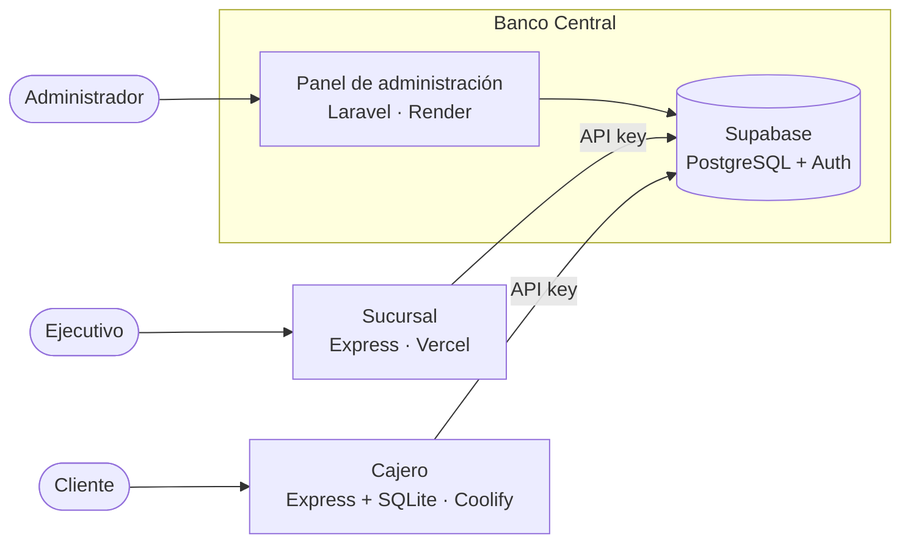

# Banco Central

Nodo central del sistema bancario distribuido (Examen 2, Tópicos de Desarrollo Web).
Aquí están la base de datos en Supabase y el panel de administración del banco.

## Arquitectura



Las sucursales y los cajeros no pueden leer ni modificar las tablas directamente (RLS activo
sin políticas). Solo pueden llamar a funciones de Postgres mandando la API key que les genera
el Banco Central. La tabla `transactions` no se puede editar ni borrar.

## Repositorios y despliegues

| Nodo | Repositorio | Despliegue |
|---|---|---|
| Banco Central | [banco-central](https://github.com/slashgarciaitc/banco-central) | Panel en Render: pendiente |
| Sucursal | [banco-sucursal](https://github.com/slashgarciaitc/banco-sucursal) | https://banco-sucursal.vercel.app |
| Cajero | [banco-cajero](https://github.com/slashgarciaitc/banco-cajero) | Coolify (autoalojado en una VM local): http://cajero.192.168.139.102.sslip.io |

El Coolify está instalado en una máquina virtual dentro de la computadora del equipo, por eso
la URL del cajero solo abre desde esa computadora.

## Base de datos

Tablas:

- `nodos`: sucursales y cajeros, con su responsable, efectivo y el hash de su API key.
- `users_accounts`: número de cuenta, titular, saldo y estado (activa o bloqueada).
- `transactions`: cuenta origen, cuenta destino, monto, tipo (retiro, depósito o transferencia) y fecha.

Funciones que usan los nodos (están documentadas en [openapi.yaml](openapi.yaml)):

| Función | Para qué |
|---|---|
| `info_nodo` | Datos del nodo dueño de la API key |
| `crear_cuenta` | Abrir una cuenta (solo sucursales) |
| `consultar_saldo` | Saldo de una cuenta |
| `retirar` | Retiro, si hay fondos en la cuenta y efectivo en el nodo |
| `depositar` | Depósito |
| `historial` | Movimientos del nodo o de una cuenta |
| `reporte_nodo` | Totales de operaciones del nodo |

`registrar_nodo` crea una sucursal o un cajero y devuelve su API key. Solo la puede usar el
panel del Banco Central (service key).

## Estructura

```
banco-central/
├── supabase/
│   └── migrations/     tablas, RLS y funciones
├── scripts/
│   ├── prueba-flujo.mjs     prueba los pasos de la demo
│   ├── registrar-nodo.mjs   crea una sucursal o un cajero
│   └── crear-usuario.mjs    crea un usuario de Supabase Auth
├── openapi.yaml
└── package.json
```

## Correr en local

Se necesita Docker y la CLI de Supabase.

```bash
supabase start
npm install
cp .env.example .env    # llenar con los datos de: supabase status -o env
npm run prueba
```

Para crear nodos y usuarios:

```bash
npm run nodo -- sucursal "Sucursal Centro" 50000 "Responsable"
npm run nodo -- cajero "Cajero Tec" 20000 "Responsable"
npm run usuario -- correo@banco.test contraseña
```
